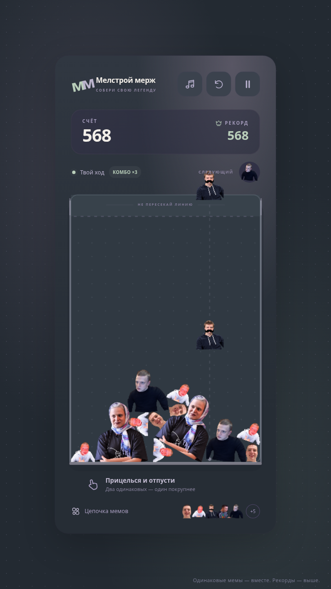
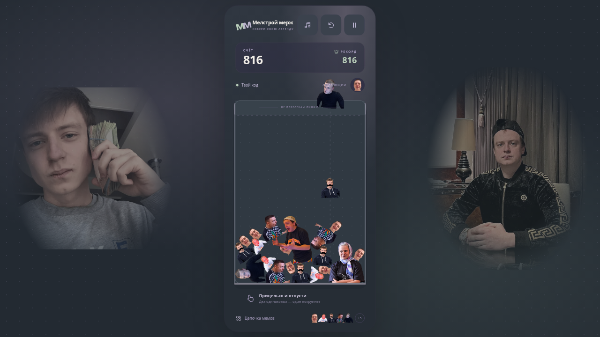

# Геймплей последней версии

Снята версия `8a0eef1` из `main` после слияния PR №4. Настоящая production-сборка: мемы появляются от касаний/кликов, сливаются физически и начисляют очки. Вертикальная запись использует касания, горизонтальная — мышь. Игровой код и физика не изменены.

## Видео

- [Вертикальное MP4](gameplay-vertical.mp4) — 720×1280, 67 секунд, 25 кадров/с.
- [Горизонтальное MP4](gameplay-horizontal.mp4) — 1280×720, 53 секунды, 25 кадров/с.

H.264, видео без звука. Можно скачать отдельные файлы через кнопку **Download raw file** на странице файла GitHub. ZIP и артефакты Actions не нужны.

## Скриншоты

| Экран | Вертикально | Горизонтально |
|---|---|---|
| Меню | [PNG](vertical-menu.png) | [PNG](horizontal-menu.png) |
| Партия | [PNG](vertical-gameplay.png) | [PNG](horizontal-gameplay.png) |
| Слияния | [PNG](vertical-merges.png) | [PNG](horizontal-merges.png) |
| Коллекция | [PNG](vertical-collection.png) | [PNG](horizontal-collection.png) |
| Итог записи | [PNG](vertical-final.png) | [PNG](horizontal-final.png) |




## Повторная запись

С установленными Chromium и FFmpeg:

```bash
npm run build
node scripts/record-gameplay.mjs
```

Для Playwright нужен его FFmpeg либо системный FFmpeg по ожидаемому пути в `PLAYWRIGHT_BROWSERS_PATH` (в этой среде используется `/workspace/.cache/playwright-media`). Исходные WebM находятся в игнорируемой `.cache/gameplay-recordings/`. Информация о разрешении, длительности, реальном счёте и отсутствии ошибок браузера — в `capture-report.json`.
